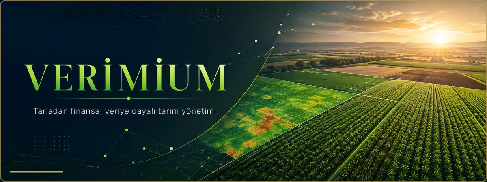

<h1 align="center">Verimium</h1>

  <strong>Tarla, hayvancılık, finans ve pazar verilerini tek mobil çalışma alanında birleştiren tarım platformu.</strong>

**Resmî web sitesi:** [verimium.app](https://verimium.app/)

  
  
  
  

## 30 saniyede ürün

| | |
| --- | --- |
| **Problem** | Tarla, hayvan, gider, gelir ve pazar bilgisinin dağınık tutulması. |
| **Çözüm** | Üretim kayıtlarını karar desteği, hatırlatmalar ve güncel içerikle tek platformda buluşturmak. |
| **Kullanıcılar** | Çiftçiler, tarım işletmeleri ve sektörel ürün/hizmet sunan firmalar. |
| **Değer** | Operasyon görünürlüğü, kayıt disiplini ve veriye dayalı planlama. |

## Modüller

- Tarla, parsel, ürün ve sezon yönetimi
- Hayvan, sürü, sağlık ve verim kayıtları
- Gelir, gider, borç ve alacak takibi
- Uydu görüntüsü ve NDVI tabanlı saha içgörüleri
- Yapay zekâ destekli tarım asistanı
- Görev, bakım, ilaçlama ve hasat hatırlatmaları
- Pazar fiyatları, haberler ve sektörel içerik
- Firma profilleri, ürün ve hizmet vitrinleri

## Ürün akışı

~~~mermaid
flowchart LR
    A[Saha kayıtları] --> B[Tarla ve sürü görünümü]
    B --> C[Uydu ve AI içgörüleri]
    C --> D[Görev ve hatırlatmalar]
    D --> E[Finans ve pazar takibi]
~~~

## Rol ve güven modeli

Çiftçi, firma sahibi, editör ve yönetici deneyimleri ayrı yetki alanlarıyla tasarlanır. Yapay zekâ ve uydu çıktıları karar desteği sunar; resmî belge, teşhis veya profesyonel danışmanlık yerine geçmez.

## Platform durumu

Android uygulaması aktif geliştirme ve mağaza hazırlığı aşamasındadır. Çiftçiler için **Premium**, firmalar için **Pro** paketlerinde aylık ve yıllık seçenekler planlanmaktadır.

[Gizlilik Politikası](https://verimium.app/privacy/)

© 2026 Verimium. Tüm hakları saklıdır.
